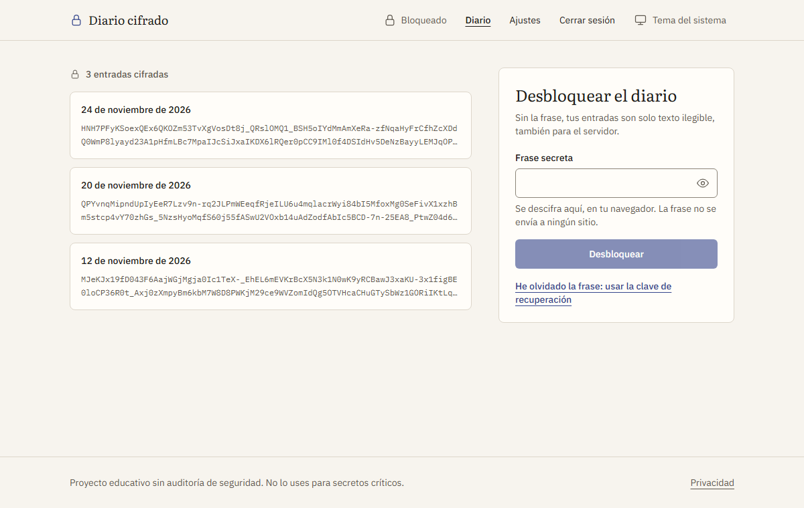
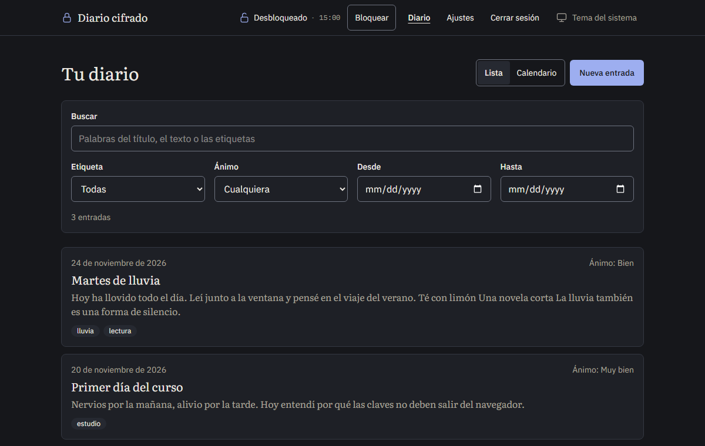
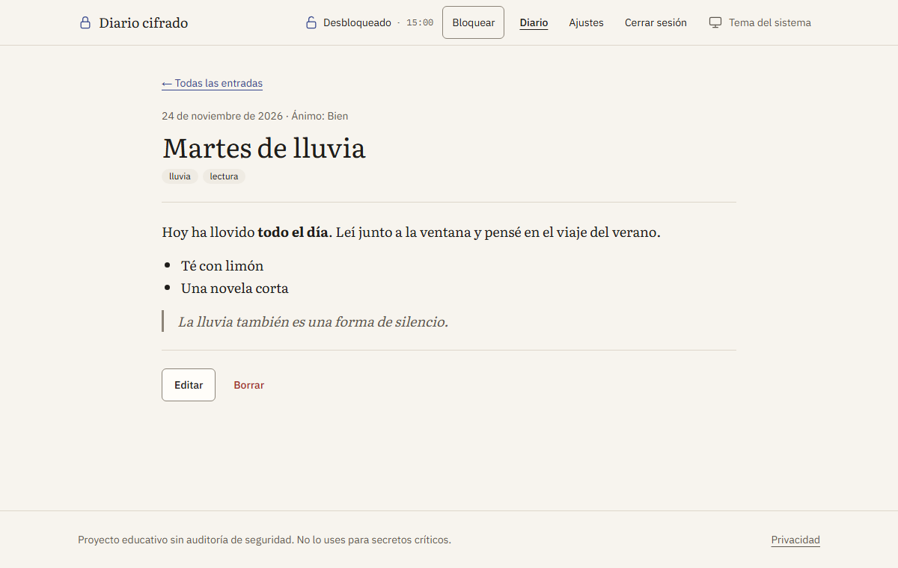
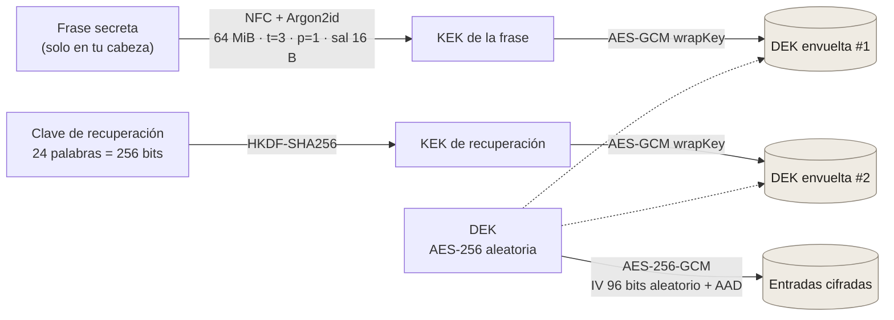
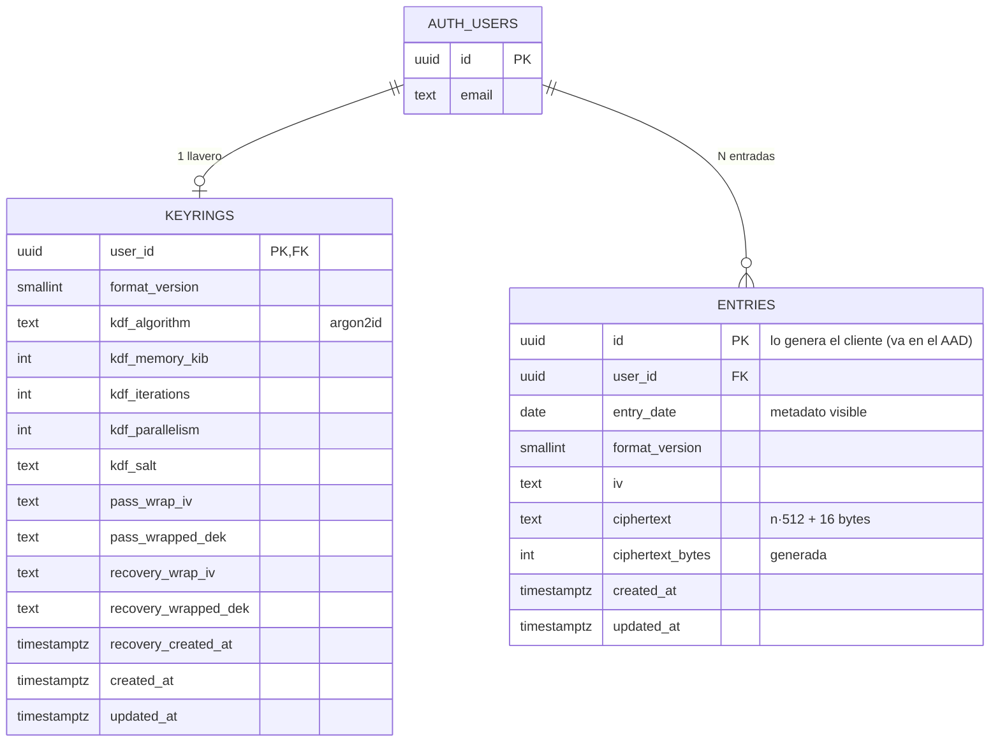

# Diario cifrado

Un diario personal con **cifrado de extremo a extremo**: las entradas se cifran en el navegador con una frase secreta que nunca sale de tu equipo. El servidor y la base de datos solo guardan texto ilegible.

Está pensado para **usarse en local**, en tu propio equipo, con Next.js y Supabase en Docker.

> ⚠️ **Proyecto educativo, sin auditoría de seguridad independiente.** Usa primitivas estándar y bibliotecas mantenidas, y está probado a fondo, pero no lo uses para secretos críticos.

| Bloqueado: solo fechas y «tinta ilegible»                                | Desbloqueado (modo oscuro)                                         | Lectura                                                        |
| ------------------------------------------------------------------------ | ------------------------------------------------------------------ | -------------------------------------------------------------- |
|  |  |  |

## Guía de uso

### 1. Instala los requisitos (una sola vez)

- **[Node.js](https://nodejs.org/)** 24 LTS (sirve desde la 20.9). Instálalo con las opciones por defecto.
- **[Docker Desktop](https://www.docker.com/products/docker-desktop/)** con WSL 2. Ábrelo una vez y acepta sus condiciones para que quede listo.
- **[Git](https://git-scm.com/)** (recomendado). Sin Git también funciona, pero la app se recompila en cada arranque y tarda más.

### 2. Descarga el diario

```powershell
git clone https://github.com/A1EX73dev/diarioEncriptado.git
```

Sin Git: en GitHub, pulsa _Code → Download ZIP_ y descomprímelo en una carpeta que no vayas a borrar.

### 3. Arranca el diario

Haz doble clic en **`Diario.cmd`**, dentro de la carpeta del proyecto. Si quieres, crea un acceso directo en el escritorio (clic derecho → _Enviar a → Escritorio_).

El lanzador abre Docker Desktop si no está abierto, instala lo necesario y abre **http://localhost:3500** en el navegador. **La primera vez tarda varios minutos**, porque descarga las imágenes de Docker y compila la app. Después arranca en segundos.

Deja abierta la ventana negra mientras uses el diario.

### 4. Crea tu cuenta

1. En la app, pulsa **Crear cuenta** y elige un correo y una contraseña.
2. Abre **http://127.0.0.1:55324**. Es un buzón local: el correo de confirmación llega ahí y **no sale de tu equipo**, así que no hace falta que el correo exista.
3. Pulsa el enlace del correo e inicia sesión.

### 5. Configura el diario

La primera vez la app te guía para:

1. **Elegir una frase secreta**, distinta de la contraseña. Es la que cifra tus entradas. Debe tener al menos 12 caracteres y el medidor debe indicar que es fuerte. Un truco: varias palabras al azar.
2. **Guardar la clave de recuperación de 24 palabras.** Cópiala o descárgala y guárdala fuera del ordenador (en papel o en un gestor de contraseñas). La app te pide algunas palabras para comprobar que la has guardado.

> ⚠️ Si pierdes **la frase y la clave de recuperación**, tus entradas no se pueden recuperar. Nadie puede hacerlo por ti.

### 6. Escribe

- **Desbloquear:** cada vez que entres, escribe tu frase secreta. Hasta entonces solo ves fechas y texto cifrado.
- **Nueva entrada:** título, texto en Markdown (negritas, listas, enlaces…), estado de ánimo y etiquetas. Tiene vista previa.
- **Buscar y filtrar** por texto, etiqueta, ánimo o fechas, o usar la **vista de calendario**.
- **Bloquear:** pulsa «Bloquear» al terminar. El diario también se bloquea si recargas la página o pasa un rato sin actividad (se cambia en _Ajustes_).

### 7. Haz copias de seguridad

Ve a **Ajustes → Exportar e importar** y descarga una **copia cifrada** de vez en cuando. Guárdala fuera del equipo: si se borra Docker o su volumen de datos, el diario desaparece. La copia se abre con la frase que tenías al exportarla.

### 8. Cierra el diario

- Cierra la ventana negra para parar la app.
- Para apagar también la base de datos y liberar memoria, haz doble clic en **`Parar diario.cmd`**. Tus entradas se conservan.

### Si olvidas algo

| Olvidaste…                  | Qué hacer                                                                                                                             |
| --------------------------- | ------------------------------------------------------------------------------------------------------------------------------------- |
| La **contraseña** de cuenta | En el inicio de sesión, «He olvidado la contraseña». El correo llega a http://127.0.0.1:55324. Tus entradas no se pierden.            |
| La **frase secreta**        | En la pantalla de desbloqueo, «He olvidado la frase: usar la clave de recuperación». Escribe las 24 palabras y elige una frase nueva. |
| La frase **y** la clave     | No hay forma de recuperar las entradas.                                                                                               |

### Actualizar a una versión nueva

```powershell
git pull
```

Después abre `Diario.cmd` como siempre. La app se recompila y aplica los cambios de la base de datos **sin borrar tus entradas**. Si descargaste el ZIP, descarga el nuevo y copia dentro la carpeta `copias/` si la tenías; los datos del diario viven en Docker, no en la carpeta.

### Problemas frecuentes

- **«No se ha podido arrancar Docker»:** abre Docker Desktop a mano, espera a que indique _Engine running_ y vuelve a abrir `Diario.cmd`.
- **«npm» no se reconoce:** falta Node.js o hay que reiniciar el equipo tras instalarlo.
- **El navegador no se abre:** entra tú en http://localhost:3500 cuando la ventana negra muestre «Diario en http://localhost:3500».
- **Otro programa usa el puerto 3500 o 5532x:** ciérralo y vuelve a intentarlo.

Sin Windows, usa las órdenes de [Uso local](#uso-local).

## Cómo funciona

El acceso tiene **dos pasos**:

1. **Cuenta** (correo y contraseña, Supabase Auth). Ves la lista de entradas, pero solo su fecha y un fragmento del bloque cifrado.
2. **Frase secreta**, distinta de la contraseña. Con ella el navegador descifra la clave del diario y puedes leer y escribir. Sin desbloquear no se puede abrir ni crear ninguna entrada.

La clave descifrada vive solo en la memoria de la página. Recargar, cerrar sesión, pulsar «Bloquear», quedarse inactivo o bloquear desde otra pestaña la descartan.

## Funcionalidades

- Registro con verificación de correo, inicio de sesión con límite de intentos, recuperación de contraseña y borrado de cuenta.
- Configuración guiada del diario: frase secreta con medidor de fortaleza (zxcvbn, en español) y **clave de recuperación de 24 palabras** que se comprueba antes de guardar nada.
- Bloqueo manual, automático por inactividad (configurable) y coordinado entre pestañas, con indicador siempre visible y cuenta atrás.
- Entradas con título, texto en **Markdown seguro**, estado de ánimo y etiquetas. Editor con vista previa y atajos.
- **Búsqueda y filtros en el navegador** (texto, etiqueta, ánimo, fechas) y **vista de calendario**.
- Cambio de frase, regeneración de la clave de recuperación y recuperación del diario sin recifrar las entradas.
- **Exportar** (copia cifrada, JSON o Markdown) e **importar** (con recifrado y sin duplicados).
- Modo claro y oscuro, accesible (WCAG 2.1 AA verificado con axe) y adaptado a móvil.

## Stack

| Capa            | Tecnología                                                                                       |
| --------------- | ------------------------------------------------------------------------------------------------ |
| Aplicación      | Next.js 16 (App Router, Server Actions, `proxy.ts`), React 19, TypeScript estricto               |
| Estilos         | Tailwind CSS 4, fuentes Literata e IBM Plex servidas localmente                                  |
| Datos y cuentas | Supabase local (PostgreSQL 17 + Auth) con `@supabase/ssr`; el navegador nunca habla con Supabase |
| Criptografía    | Web Crypto (AES-256-GCM, HKDF), `hash-wasm` (Argon2id en un Web Worker), `@scure/bip39`          |
| Validación      | zod en cliente y servidor, y restricciones `CHECK` en la base de datos                           |
| Tests           | Vitest, pgTAP, Playwright y axe-core                                                             |
| CI              | GitHub Actions y Dependabot                                                                      |

## Diseño criptográfico



Lo que aparece en gris es lo único que guarda el servidor.

| Elemento               | Decisión                                              | Motivo                                                                                                                                                                                                                             |
| ---------------------- | ----------------------------------------------------- | ---------------------------------------------------------------------------------------------------------------------------------------------------------------------------------------------------------------------------------- |
| Cifrado de entradas    | AES-256-GCM, IV aleatorio de 96 bits en cada guardado | Cifrado autenticado estándar y nativo del navegador. El límite de NIST para IV aleatorios (2³² cifrados por clave) queda muy lejos.                                                                                                |
| Derivación de la frase | **Argon2id**, 64 MiB, t=3, p=1, sal de 16 B           | Necesita mucha memoria, lo que encarece los ataques con GPU mucho más que PBKDF2. Supera el mínimo de OWASP (19 MiB, t=2). Con un solo hilo en WASM, más paralelismo no añadiría seguridad. Unos 360 ms en Chromium de escritorio. |
| Por qué no PBKDF2      | Descartado                                            | Con 600 000 iteraciones solo consume CPU, y una GPU prueba muchas más frases por segundo.                                                                                                                                          |
| Clave de recuperación  | 256 bits mostrados como 24 palabras BIP39 + HKDF      | Es aleatoria, así que no necesita una derivación lenta. BIP39 añade una suma de control que detecta errores al escribirla.                                                                                                         |
| Verificar la frase     | Intentar desenvolver la DEK                           | Si la etiqueta GCM falla, la frase es incorrecta. No se guarda ningún verificador adicional.                                                                                                                                       |
| Datos asociados (AAD)  | `dominio\|entry\|v1\|user_id\|entry_id`               | Una entrada no se puede mover a otro usuario ni a otro identificador. El llavero también va ligado al usuario, a su ranura y a sus parámetros.                                                                                     |
| Relleno                | Bloques de 512 bytes                                  | Reduce lo que revela la longitud del texto.                                                                                                                                                                                        |
| Clave en memoria       | `CryptoKey` **no extraíble**                          | Nunca va a `localStorage`, `sessionStorage`, IndexedDB, cookies ni al servidor.                                                                                                                                                    |
| Cambio de frase        | Volver a envolver la DEK                              | Se usa una sal nueva y el coste vigente, sin recifrar las entradas.                                                                                                                                                                |

El detalle y la API del módulo están en [src/lib/crypto/README.md](src/lib/crypto/README.md).

## Modelo de datos



- **RLS activado y forzado** en las dos tablas: cada usuario solo lee, crea, modifica y borra sus filas.
- **Privilegios por columna**: nadie puede cambiar `id`, `user_id` ni `created_at`, y el llavero no se puede borrar directamente.
- **`ON DELETE CASCADE`**: borrar la cuenta borra el llavero y todas las entradas.
- **Restricciones `CHECK`** que replican los esquemas zod: base64url, tamaños exactos, parámetros de Argon2id entre 19 y 256 MiB, versión de formato.
- **Limitador de login** en un esquema `private` no expuesto. Guarda HMAC del correo y de la IP, nunca los valores en claro, y los borra a las 24 h.

Migraciones en [supabase/migrations](supabase/migrations) y tests de RLS en [supabase/tests/database](supabase/tests/database).

**Lo que ve el servidor (metadatos):** tu correo, el número de entradas y la fecha de cada una, sus fechas de creación y modificación, su tamaño redondeado a 512 bytes y los parámetros públicos del cifrado. **No ve** el título, el texto, el ánimo, las etiquetas, la frase, la clave de recuperación ni lo que buscas.

## Modelo de amenazas (uso local)

**Protege frente a:**

- Alguien que copie la base de datos, el volumen de Docker o una copia de seguridad SQL: solo encuentra texto cifrado y tendría que adivinar tu frase, a 64 MiB por intento.
- Quien lea las tablas con permisos de administrador.
- La manipulación de filas: una entrada alterada, movida o intercambiada no se descifra y se marca como dañada.
- XSS a través del contenido: el Markdown se renderiza sin HTML crudo, y una CSP estricta con nonce bloquea scripts y manejadores inline.

**No protege frente a:**

- **Código malicioso servido por la app.** Si alguien modifica el código o una dependencia, puede robar la frase al escribirla. Es la limitación inherente de cualquier app web con cifrado de extremo a extremo. Las dependencias están fijadas con lockfile y se revisan con `npm audit` y Dependabot.
- **Malware o extensiones del navegador** en tu equipo.
- **Alguien que use tu equipo** mientras el diario está desbloqueado (el autobloqueo lo mitiga).
- **Una frase débil** frente a un ataque sin conexión: por eso se exige una puntuación de zxcvbn de 3 o más y al menos 12 caracteres.
- **Los metadatos** listados arriba.

**Compromisos asumidos:**

- Si pierdes la frase **y** la clave de recuperación, tus entradas son **irrecuperables**.
- No hay búsqueda en el servidor: se descifra todo en el navegador.
- Recargar la página bloquea el diario.
- JavaScript no garantiza borrar la memoria: al bloquear se sueltan las referencias, pero es una medida de mejor esfuerzo.

## Seguridad de la aplicación web

- **CSP** con un nonce nuevo por petición y `'strict-dynamic'`, sin `unsafe-inline` ni `unsafe-eval` en producción, y `connect-src 'self'`. Sin `upgrade-insecure-requests` ni HSTS, porque la app se sirve en `http://localhost`.
- **Cabeceras**: `X-Content-Type-Options`, `Referrer-Policy: no-referrer`, `X-Frame-Options`, `Permissions-Policy` restrictiva, COOP/CORP y `Cache-Control: no-store` en las páginas privadas.
- **Cookies de sesión** `HttpOnly` y `SameSite=Lax`; `Secure` en producción.
- **CSRF**: las Server Actions solo aceptan POST y comprueban `Origin` frente a `Host`.
- **Entradas validadas con zod** en el servidor, y mensajes genéricos que no revelan si un correo existe.
- **Secretos** solo en variables de entorno del servidor; ninguna lleva `NEXT_PUBLIC_`.
- **Sin terceros**: ni analíticas, ni fuentes ni scripts externos.

## Uso local

### Requisitos

- Node.js **24 LTS** (funciona desde 20.9).
- **Docker Desktop** con WSL 2 en Windows.

### Dos instancias separadas

| Instancia          | Puertos                                  | Para qué                                                                   |
| ------------------ | ---------------------------------------- | -------------------------------------------------------------------------- |
| `diario-personal`  | API 55321 · correos 55324 · app **3500** | **Tu diario real.** Ni los tests ni `db:reset` la tocan.                   |
| `diarioEncriptado` | API 54321 · correos 54324 · app 3000     | Desarrollo, tests y CI. Se puede llenar de usuarios de prueba y reiniciar. |

### Uso diario

En Windows basta con `Diario.cmd` (ver [Guía de uso](#guía-de-uso)). Desde la terminal, en cualquier sistema:

```powershell
npm ci
```

```powershell
npm run diario
```

La primera vez descarga las imágenes de Docker y tarda unos minutos. Después abre **http://localhost:3500**, crea tu cuenta y confirma el correo en **http://127.0.0.1:55324**: los correos no salen de tu equipo.

La app solo se vuelve a compilar si no hay build o si el código ha cambiado (otro commit o cambios sin commit); así el arranque diario tarda unos segundos.

| Orden                                            | Qué hace                                                                                                             |
| ------------------------------------------------ | -------------------------------------------------------------------------------------------------------------------- |
| `npm run diario`                                 | Arranca Supabase personal, aplica las migraciones nuevas **sin borrar datos**, compila si hace falta y sirve la app. |
| `npm run diario -- --compilar`                   | Igual, forzando la compilación.                                                                                      |
| `npm run diario:parar`                           | Para Supabase personal. **Los datos se conservan.**                                                                  |
| `npm run diario:copia`                           | Guarda una copia SQL en `copias/`. Las entradas van cifradas; la copia incluye tu correo y el hash de tu contraseña. |
| `npm run diario:restaurar -- copias/archivo.sql` | Sustituye los datos actuales por la copia. Pide escribir `RESTAURAR`.                                                |

Además de las copias SQL, desde la app (Ajustes → Exportar e importar) puedes descargar una **copia cifrada** del diario. Guarda las copias fuera del equipo: si se borra el volumen de Docker, el diario desaparece.

## Desarrollo

```powershell
npm ci
```

```powershell
npm run db:start
```

```powershell
npm run env:local
```

```powershell
npm run dev
```

`env:local` genera `.env.local` con las claves de la instancia de desarrollo (ver [.env.example](.env.example)). La app de desarrollo queda en http://localhost:3000 y los correos en http://127.0.0.1:54324.

### Tests

| Orden                      | Qué prueba                                                                                                           |
| -------------------------- | -------------------------------------------------------------------------------------------------------------------- |
| `npm test`                 | Unitarios (Vitest): criptografía, Markdown sin XSS, filtros, copias…                                                 |
| `npm run test:db`          | pgTAP: RLS, privilegios, restricciones y limitador                                                                   |
| `npm run test:integration` | RLS a través de la API real, con datos cifrados de verdad                                                            |
| `npm run test:e2e`         | Playwright contra el **build de producción** (puerto 3100), con comprobación de CSP en cada página y análisis de axe |
| `npm run bench:kdf`        | Coste de Argon2id en Node                                                                                            |

Los tests de base de datos, integración y E2E necesitan `npm run db:start`. La CI ([.github/workflows/ci.yml](.github/workflows/ci.yml)) ejecuta lint, tipos, formato, `npm audit` y todos los tests en cada push y pull request.

### Estructura

```
src/
  app/            rutas (público, (auth), (app) privada, auth/confirm, privacidad)
  components/     interfaz: diary/, vault/, settings/, auth/, ui/
  lib/
    crypto/       módulo de criptografía aislado (sin React) + tests
    vault/        clave en memoria, autobloqueo, intentos, worker de Argon2id
    entries/      descifrado, filtros, calendario, copias
    dal/          acceso a datos en el servidor (server-only) y Server Actions
    auth/         acciones de autenticación, sesión, limitador
    security/     CSP y cabeceras
  proxy.ts        nonce + CSP + refresco de sesión
supabase/         configuración, migraciones, plantillas de correo y tests pgTAP
scripts/          diario.mjs (uso diario y copias) y write-env.mjs
tests/            integration/ y e2e/
```

## Limitaciones conocidas

- El rendimiento de Argon2id **no se ha medido en móviles**. Los parámetros están guardados con cada usuario, así que se pueden ajustar sin romper nada.
- La copia cifrada se abre con la frase que tenía el diario al exportarla, no con la clave de recuperación.
- Copiar la clave de recuperación al portapapeles la deja ahí hasta que copies otra cosa; la interfaz lo avisa.
- El límite de intentos de desbloqueo vive en el navegador: frena a quien prueba frases en tu equipo, pero no a un ataque sin conexión.
- El Markdown admite un subconjunto deliberado: sin imágenes, tablas ni HTML.
- Pendiente y opcional: segundo factor (TOTP) para el inicio de sesión.
